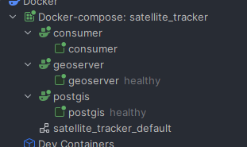
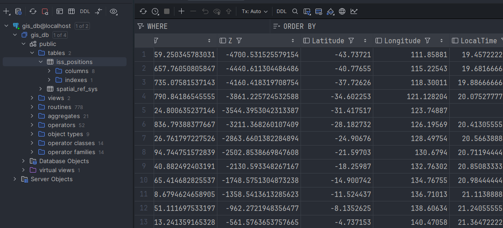
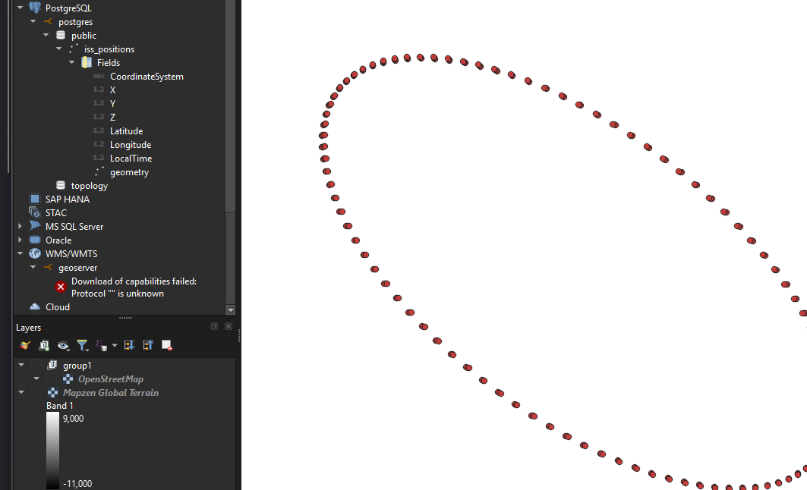

# Satellite tracker

### Summary
Small learning project using NASA's Satellite Situation Center Web (SSCWeb) to map satellite locations or the ISS by default.

This project uses the sscws python package to query the location data. Additional information on this API can be found at the following resource:
- https://sscweb.gsfc.nasa.gov/WebServices/REST/

### Stack
The build is overly complicated for learning purposes but follows the following data flow:
1. Consumer > PostGIS > GeoServer > QGIS 

### Deployment
1. Run docker compose
```bash
docker compose -f docker-compose.yml -p satellite_tracker up -d
```

2. Trigger the flask app
```bash
curl http://localhost:5000/
```


3. Check postgis



4. Open with QGIS

